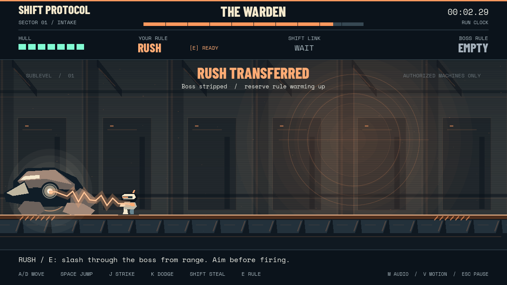

# STEAL THE RULES: SHIFT PROTOCOL

**One slot. Three machines. Their rules are yours.**

A 2D boss rush about stealing the rules of a fight. Survive a machine's attack, get close while its core is open, then press **SHIFT**. You take its active rule. It inherits whatever you were carrying. Think twice before giving a fast machine its charge back.

Built by Carey for [GitHub Game Off 2026](https://itch.io/jam/game-off-2026) in Godot 4.7.2 / GDScript. Targets desktop browsers and Windows x64.

## Field manual

| Action | Keyboard | Controller |
| --- | --- | --- |
| Engage / continue | Enter | Start or A |
| Move | A/D or arrows | Left stick / D-pad |
| Jump | Space, W or ↑ | A |
| Strike (can hold) | J or Z | X |
| Dodge | K or X | B |
| Steal / exchange | Shift or Q | Right bumper |
| Use carried rule | E or C | Y |
| Pause | Esc or P | Start |
| Reboot current sector | R | Back / Select |

**RUSH** dashes through danger and cuts in the direction you face. **LIFT** jets you upward; strike during the ascent to pierce armor. **AEGIS** catches a hit and reflects damage if the boss is close enough. A rule has one charge, replenished after the next boss attack or successful transfer. Each sector restores up to three hull points and preserves your current rule. Rebooting restores the sector's entry state. The run clock excludes menus and pause; a reboot rolls it back to sector entry.

On the title screen, **H** widens reaction windows and lengthens protection after a hit. **M** toggles audio and **V** reduces camera motion, flashing, and effects. These settings and the best standard run time save locally. Use **T** on the pause or defeat screen to return to the title. **F11** toggles fullscreen on Windows. On Web, click the game to focus the canvas if keys do not respond.

[中文操作指南](docs/PLAY-ZH.md) · [Build and submission instructions](docs/BUILD.md)

## Source

- `src/arena.gd` — combat, input, encounters, sector resets and run state
- `src/arena_art.gd` — machine silhouettes, arena art, warning zones and HUD
- `src/sound.gd` — synthesized sound effects and score
- `tests/smoke.gd` — automated keyboard binding, combat, rule-transfer and full-run checks

Original project files are [MIT licensed](LICENSE). Barlow Condensed and Space Mono are bundled under their respective [OFL notices](assets/). [Godot Engine](https://godotengine.org/license/) and its dependencies have separate [notices](docs/GODOT_COPYRIGHT.txt).

**AI disclosure:** OpenAI Codex assisted with game design, GDScript, procedural visual and sound code, test tooling, and documentation. The game contains no runtime AI and needs no network connection after loading.
