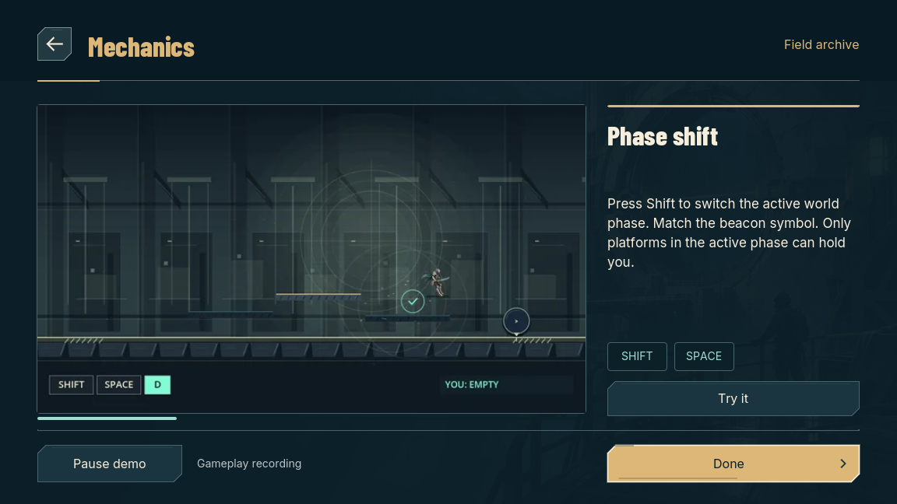

# STEAL THE RULES: SHIFT PROTOCOL

**English** · [简体中文](docs/readme/zh-CN.md) · [繁體中文](docs/readme/zh-TW.md) · [日本語](docs/readme/ja.md) · [한국어](docs/readme/ko.md)

A 2D action game where SHIFT trades your rule with the boss. You take its ability; it has to fight with the one you gave up.

[Download Windows x64](https://github.com/Carey0216/steal-the-rules-shift-protocol/releases/latest/download/shift-protocol-windows-x64.zip) · [Download Web HTML5](https://github.com/Carey0216/steal-the-rules-shift-protocol/releases/latest/download/shift-protocol-web.zip) · [v1.7.0](https://github.com/Carey0216/steal-the-rules-shift-protocol/releases/tag/v1.7.0)

## Play

Extract the Windows ZIP and open **ShiftProtocol.exe**. Keep its `runtime` folder beside it. For Web, upload the ZIP to itch.io or serve `index.html` over HTTP in a desktop browser.

## Two ways to play

**Protocol run** puts the six bosses back to back. Carry your rule into the next fight, repair up to three hull after each clear and retry from the current boss. Each boss changes its attack pattern at 67% and 34% health.

**Operation** is the saved 48-sector campaign across eight regions. It mixes boss fights with phase platforms, anchor swaps, moving ferries, cargo routes and guardian encounters.

Read the attack, dodge or jump clear, then approach the exposed core. The preview shows what each side will receive. Press **SHIFT** to exchange and **E** to use your rule. RUSH trades positions and cuts forward; LIFT grounds the boss and launches you; AEGIS strips armor and lets you catch and reflect a nearby hit.

## Controls

| Action | Keyboard | Controller |
| --- | --- | --- |
| Move left / right | A / D | Stick / D-pad |
| Jump | Space | A |
| Strike; hold to repeat | J | X |
| Dodge | K | B |
| Exchange rules | Shift | RB |
| Use your rule | E | Y |
| Pause | Esc | Start |
| Retry | R | Back |
| Confirm briefing | Enter | A |

Keyboard controls can be remapped. Settings also include larger text, assist mode, reduced motion, separate audio levels and screen shake strength. The archive contains gameplay recordings and hands-on drills.

## MONEY — experimental coin editor

For trying different equipment without replaying sectors for coins.

1. In the lobby, click the coin balance **five times within 2.4 seconds**.
2. Enter **MONEY** and confirm.
3. When the amount prompt appears, enter an integer from **0 to 999999999** and confirm.

This sets the saved coin balance. It does not unlock sectors or change stars. The entry stays hidden in the game.

## Screenshots

## Build from source

Open `project.godot` in **Godot 4.7.2 standard** and press F5. For Web and Windows exports, see [BUILD.md](docs/BUILD.md).

## Credits

Created by Carey. Codex assisted with programming, design, procedural visuals/audio, translation and documentation. The operative artwork, pose sheet and gate background were made with OpenAI image generation. No runtime AI. [AI use](docs/AI-DISCLOSURE.md) · [Asset notes](assets/ART-NOTES.txt)

Original project files use [MIT](LICENSE). Fonts and Godot keep their own notices.
