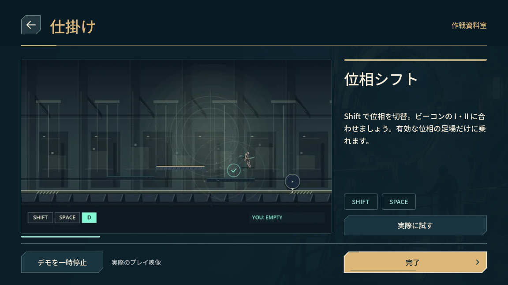

# STEAL THE RULES: SHIFT PROTOCOL

[English](../../README.md) · [简体中文](zh-CN.md) · [繁體中文](zh-TW.md) · [日本語](ja.md) · [한국어](ko.md)

SHIFTでボスとルールを交換する2Dアクションゲーム。相手の能力を奪うと、自分が持っていたルールが相手に渡ります。

[Windows版](https://github.com/Carey0216/steal-the-rules-shift-protocol/releases/latest/download/shift-protocol-windows-x64.zip) · [Web HTML5版](https://github.com/Carey0216/steal-the-rules-shift-protocol/releases/latest/download/shift-protocol-web.zip) · [v1.7.0](https://github.com/Carey0216/steal-the-rules-shift-protocol/releases/tag/v1.7.0)

## 遊ぶ

WindowsのZIPを展開し、**ShiftProtocol.exe**を起動。`runtime`フォルダは移動しないでください。Web版はitch.ioへアップロードするか、HTTPサーバーからデスクトップブラウザーで開きます。

## 2つのモード

**プロトコル挑戦**では6体のボスと連続で戦います。ルールを次戦へ持ち越し、勝利で装甲を最大3回復。失敗しても現在のボスから再挑戦できます。体力67%と34%で攻撃パターンが変化します。

**作戦**は8エリア・48区画のキャンペーン。位相の足場、アンカー交換、移動渡台、貨物運搬やガーディアン戦を進めます。進行状況は自動保存されます。

予告攻撃を回避し、開いたコアへ近づきます。交換前の表示で両者の次のルールを確認し、**SHIFT**で交換、**E**で発動。RUSHは位置交換と突進斬り、LIFTはボスの着地と自分の上昇、AEGISは装甲破壊と近距離での反射を行います。

## 操作

| 操作 | キーボード | コントローラー |
| --- | --- | --- |
| 左右移動 | A / D | Stick / D-pad |
| ジャンプ | Space | A |
| 斬撃・長押しで連続攻撃 | J | X |
| 回避 | K | B |
| ルール交換 | Shift | RB |
| 能力を使う | E | Y |
| 一時停止 | Esc | Start |
| 再挑戦 | R | Back |
| 戦闘開始の確認 | Enter | A |

キー変更、文字サイズ、アシスト、動きを減らす設定、音量と画面の揺れを調整できます。作戦資料室で実機映像と練習を開けます。

## MONEY：実験的なコイン編集

装備を気軽に試すための隠し機能です。

1. ロビーのコイン残高を**2.4秒以内に5回クリック**。
2. **MONEY**と入力して確定。
3. 金額入力画面で**0～999999999**の整数を入力し、確定します。

保存済みのコイン残高だけを変更します。区画や星は変わりません。

## スクリーンショット

## ソースから実行

**Godot 4.7.2標準版**で`project.godot`を開き、F5で実行。エクスポート手順は[BUILD.md](../BUILD.md)へ。

## 制作・ライセンス

制作：Carey。Codexがプログラム、設計、手続き型描画・音声、翻訳と文書作成を補助しました。キャラクター、ポーズ集と背景はOpenAIの画像生成を使用。実行時AIはありません。[AI利用](../AI-DISCLOSURE.md) · [素材記録](../../assets/ART-NOTES.txt)

独自ファイルは[MIT](../../LICENSE)。フォントとGodotには別のライセンスがあります。
