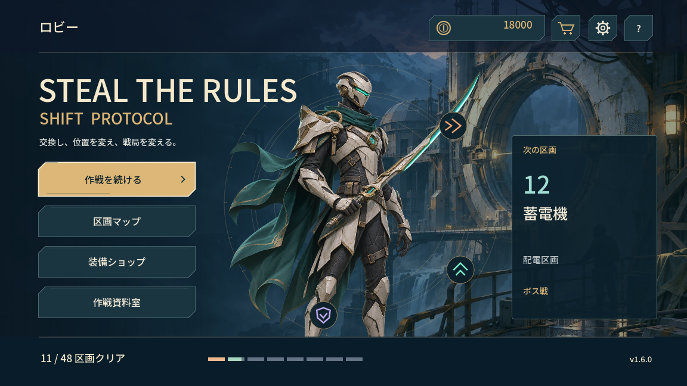
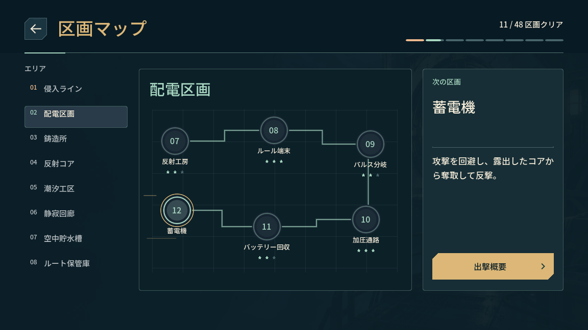
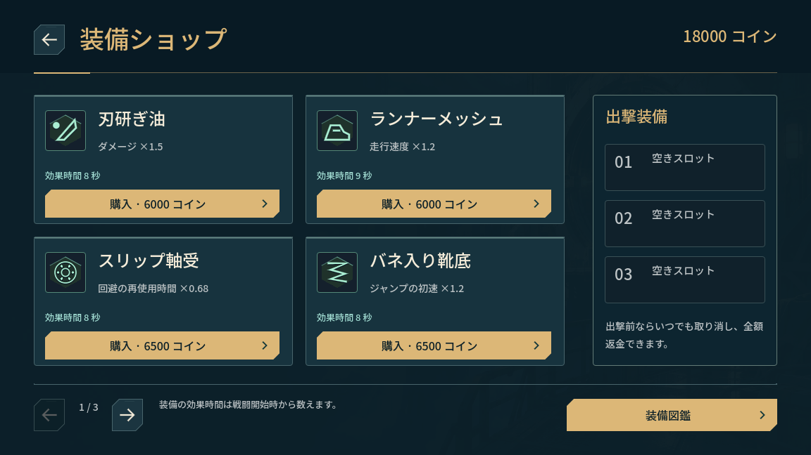

<h1 align="center">STEAL THE RULES: SHIFT PROTOCOL</h1>

  
  
  
  

[English](../../README.md) · [中文（简体）](../../docs/readme/zh-CN.md) · [中文（繁體）](../../docs/readme/zh-TW.md) · **日本語** · [한국어](../../docs/readme/ko.md)

戦いのルールを奪う 2D ボスラッシュ。GitHub Game Off 2026 向けに Godot と GDScript で制作しました。

## 主な機能

| | |
| --- | --- |
| 48区画・8エリア | 19種類のルート、14区画のボス戦、13ルートの終点にガーディアン戦。各エリアの最後はボス戦です。 |
| 3つの Shift | 敵とのルール交換、アンカーとの位置交換、足場の実体を切り替える位相シフト。 |
| パーフェクト回避 | 命中直前に回避すると、2秒以内の次の斬撃を一度だけ4ダメージ強化。通常回避の無敵時間は維持。 |
| 変更できる出撃装備 | 短時間効果の装備23種。異なる3種まで購入。出撃前は購入済みスロットを押して全額返金・変更できます。弱体化装備は戦闘ドロップのみ。 |
| ガイドと設定 | 実機映像29本と練習。キー変更、全体・音楽・効果音の個別音量、画面の揺れを調整可能。左下に現在のキーと操作名を常時表示。 |

次の作戦へ進むか、マップ・ショップ・資料室・設定を開きます。

エリアと区画を選び、出撃前に目標を確認。

装備には効果時間を明記。右側の購入済みスロットを押すと返金できます。

位相シフトのガイド。左に実機映像、右に手順とキーを表示。

## 操作方法

| 操作 | 初期キーボード | コントローラー |
| --- | --- | --- |
| メニュー決定 | Enter | A |
| 左へ移動 | A | ← Stick |
| 右へ移動 | D | Stick → |
| ジャンプ | Space | A |
| 斬撃（長押し可） | J | X |
| 回避 | K | B |
| シフト / 交換 | Shift | RB |
| 現在のルールを使う | E | Y |
| 一時停止 | Esc | Start |
| 再挑戦 | R | Back |

## Shift で戦局を変える

**RUSH** を奪うとプレイヤーとボスの位置が入れ替わり、敵の方向を向きます。**LIFT** を奪うとボスが地上に降り、ラティスの床は崩落。**AEGIS** を奪うと装甲が剥がれ、短時間ダメージが増えます。ボスは渡された元のルールで次の攻撃を変えます。交換前に両方のアイコンを確認しましょう。

## 攻略ガイド

1. Windows ZIP 全体を展開して **ShiftProtocol.exe** を実行し、runtime フォルダを残します。初回は全画面です。言語を選び、基本の5レッスンと「実際に試す」で操作を覚えます。

2. 赤い予兆を見て回避するか範囲外へ移動。開いたコアのそばで **Shift** を押して交換し、**E** でルールを使います。回避はゲージが満ちると再使用できます。

3. 攻撃が届く直前に **K** で回避するとパーフェクト回避。金色のリングと音が合図です。2秒以内の次の斬撃が一度強化されます。

4. 位相ルートは **I / II** に合わせて Shift。アンカールートは大きなリング内で Shift を押して位置を交換します。初めての仕掛けは映像で説明され、**？** で見直せます。

5. チェックポイントの後にガーディアンが現れる区画があります。倒すとクリア。再挑戦でも星1つにつき1000コイン。購入済み装備は出撃前なら全額返金できます。購入効果は戦闘開始から7～9秒です。

6. 歯車で設定。操作ごとにキーは1つで、使用中のキーを選ぶと割り当てが交換されます。左下の案内も更新。音量3系統と画面の揺れを個別調整できます。Esc で一時停止し、保存して終了で進行を残せます。

## 起動とビルド

Web 版はデスクトップブラウザー用です。HTTP で index.html を開くか、Web ZIP を itch.io にアップロードしてください。ソースは標準版 Godot 4.7.2 を使用。ビルド手順にエクスポートとテストを記載しています。

[タグ付きバージョンを取得](https://github.com/Carey0216/steal-the-rules-shift-protocol/releases) · [ビルド手順](../BUILD.md)

## クレジットとライセンス

Carey 制作。Codex はコード、テスト、文書、キャラクターイラストと動作ポーズの生成を補助しました。実行中の AI は使用しません。独自ファイルは MIT、フォントは SIL OFL、Godot と依存ライブラリは各ライセンスです。UI研究参考は Hell759735653 の Ember Veil と FunX の Foundation UI。参考作品の画像は同梱していません。

[アートと参考資料](../../assets/ART-NOTES.txt)
