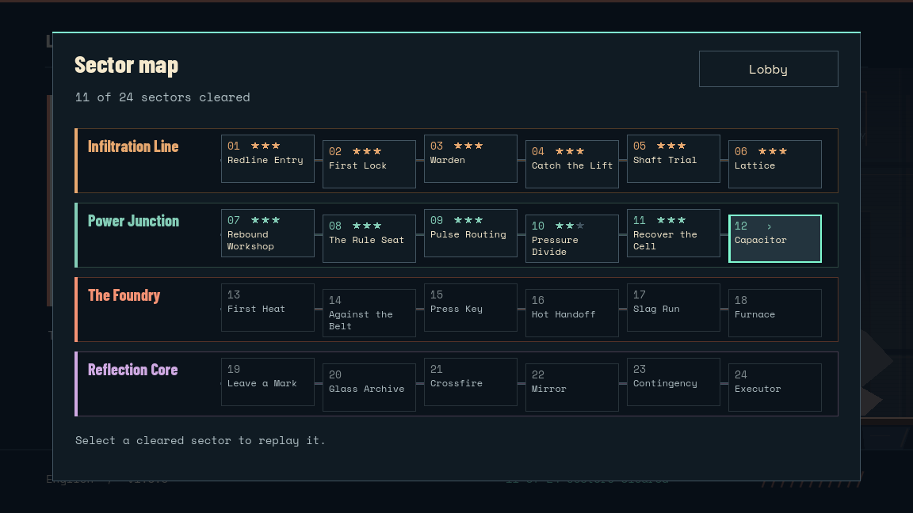

<h1 align="center">STEAL THE RULES: SHIFT PROTOCOL</h1>

  
  
  
  

[English](../../README.md) · [中文（简体）](../../docs/readme/zh-CN.md) · [中文（繁體）](../../docs/readme/zh-TW.md) · **日本語** · [한국어](../../docs/readme/ko.md)

戦いのルールを奪う 2D ボスラッシュ。GitHub Game Off 2026 向けに Godot と GDScript で制作しました。

## ゲームの特徴

| 機能 | 内容 |
| --- | --- |
| SHIFT で交換 | 攻撃を回避して開いたコアに近づき、**Shift** を押します。ボスの能力を奪い、持っていたルールを相手に渡します。 |
| 全 24 区画・4 エリア | ロック破壊、ゲート追跡、通電床、パルス反射、貨物運搬、残響ロックに挑みます。6 体のボスの耐久は約 35% 増加。最終戦のあとには脱出があります。 |
| マップとセーブ | クリアで区画が点灯し、次が開放されます。クリア済みの区画は再挑戦して再評価できます。Esc で一時停止し、歯車メニューで保存終了・進行消去ができます。 |
| 実プレイ映像 | 初回の 5 レッスンには練習場があります。新しい仕掛けに入る前に実演を再生し、ロビーの **？** から再視聴できます。装備図鑑もここにあります。 |
| 装備とショップ | 個別のアイコンを持つ装備が 20 種類。1 回のクリアで 1000～3000 コイン。出撃前に異なる装備を最大 3 種類購入できます。弱体化装備はドロップ専用です。 |
| 設定 | 言語、画面モード、ウィンドウサイズ、文字サイズを変更できます。音声、動きの軽減、アシストも切り替えられます。Windows 版は初回に全画面で起動し、以降は設定を保存します。Web 版はページ内で起動し、設定から全画面にできます。 |

## 操作方法

| 操作 | キーボード | コントローラー |
| --- | --- | --- |
| 開始 / 続ける | Enter | Start / A |
| 移動 | A/D または矢印キー | 左スティック / 十字キー |
| ジャンプ | Space、W または ↑ | A |
| 斬撃（長押しで連続） | J または Z | X |
| 回避 | K または X | B |
| 奪取 / 交換 | Shift または Q | 右バンパー |
| 現在のルールを使う | E または C | Y |
| 一時停止 | Esc または P | Start |
| 現在の区画をやり直す | R | Back / Select |

## ルールと回復

**RUSH** は前方への突進斬り。**LIFT** は上昇し、その間に斬撃を出すと装甲を貫けます。**AEGIS** は攻撃を一度受け止め、ボスが近ければダメージを返します。次のボスの攻撃が終わるか、奪取が成功すると再使用できます。次の区画に入ると耐久が最大 3 回復します。やり直すと区画に入った時点の状態に戻ります。

## 攻略ガイド

1. **起動。** Windows x64 では ZIP 全体を展開し `ShiftProtocol.exe` を起動。Web HTML5 では HTTP サーバーで `index.html` を開くか、ZIP を itch.io へブラウザーゲームとしてアップロードします。ブラウザーでは画面をクリックして入力を有効にします。
2. **最初の交換。** 予告を見て、攻撃が届く直前に K で回避します。開いたコアに近づき、範囲内表示が出たら Shift、Q または右バンパー。E または Y でルールを使い、J または X で攻撃します。失敗したら次の開放を待って近づきます。
3. **仕掛け。** 反射マーカーに立ち、予告が消える直前に E で AEGIS を使います。残響ロックでは照準が固定されたら離れます。貨物のそばで J を押し、各地点へ順に運びましょう。
4. **カプセル。** フィールドに泡がなく、ドロップの待ち時間が終わっていれば、有効な命中で 12% の確率で落下します。泡は 6 秒で消え、近づくと 5～9 秒だけ有効。緑は強化、赤は 5 秒の弱体化です。HUD に残り時間が出ます。
5. **コインと評価。** クリアで星 1 つ、区画ごとの時間と被弾回数の条件でさらに 1 つずつ。再挑戦でも星 1 つにつき 1000 コイン。価格は 6000 から。ロビーのカートか出撃前画面を開き、各装備を 1 個まで購入できます。効果時間は出撃から数えます。
6. **再挑戦と保存。** 結果から再挑戦、ロビー、次の区画を選べます。歯車から進行を消去すると、区画記録、星、コイン、購入済み装備が消去されます。言語、表示、アクセシビリティ設定は保持されます。

## 起動とビルド

Windows では ZIP 全体を展開して `ShiftProtocol.exe` をダブルクリックします。隣の `runtime` フォルダはそのまま残してください。デスクトップのブラウザーでは、ゲーム画面をクリックしてから操作してください。ソースから起動するには、標準版 Godot 4.7.2 で `project.godot` を開き F5 を押します。ビルド手順にはエクスポートテンプレート、テスト、Web 版と Windows 版の ZIP 作成方法があります。

[タグ付きリリースをダウンロード](https://github.com/Carey0216/steal-the-rules-shift-protocol/releases) · [ビルド手順（英語）](../BUILD.md) · [Game Off 2026](https://itch.io/jam/game-off-2026)

## クレジットとライセンス

Carey が GitHub Game Off 2026 向けに制作しました。OpenAI Codex は設計、GDScript、手続き的に生成する映像・音声、テスト、文書作成を補助しました。ゲーム実行中に AI は使用しません。独自のプロジェクトファイルは MIT ライセンスです。Barlow Condensed、Space Mono、Noto Sans をサブセット化した Shift Sans の各フォントに SIL Open Font License が付属します。Godot と依存ライブラリのライセンスは別途記載しています。

[MIT](../../LICENSE) · [SIL OFL](../../assets/) · [Godot](../GODOT_COPYRIGHT.txt)
