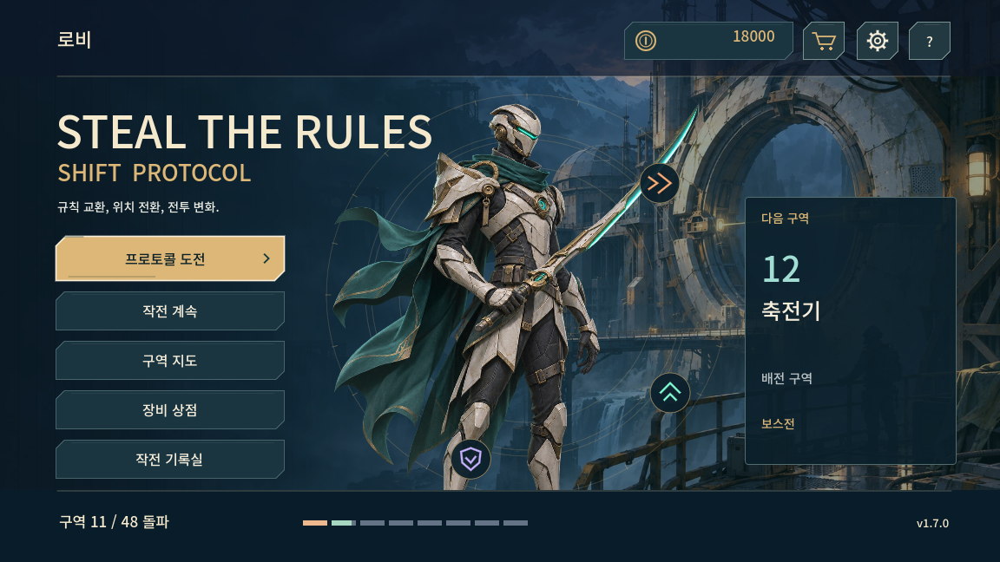
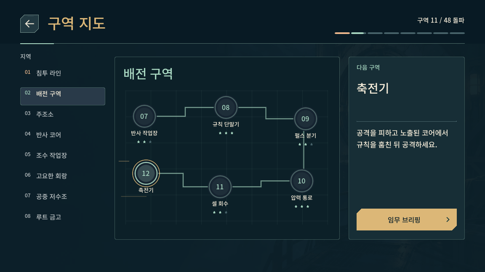
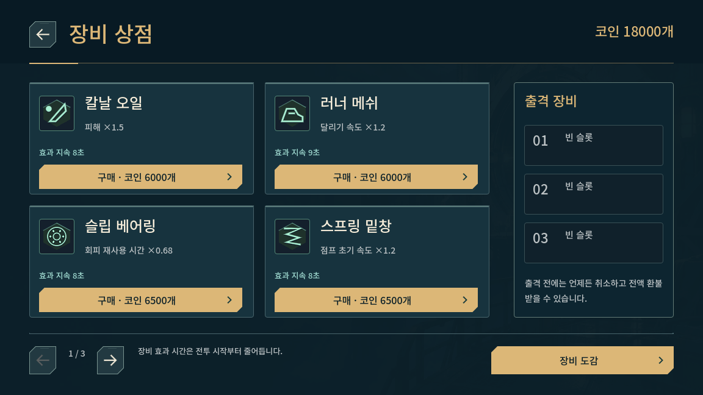

<h1 align="center">STEAL THE RULES: SHIFT PROTOCOL</h1>

  
  
  
  

[English](../../README.md) · [中文（简体）](../../docs/readme/zh-CN.md) · [中文（繁體）](../../docs/readme/zh-TW.md) · [日本語](../../docs/readme/ja.md) · **한국어**

전투의 규칙을 훔치는 2D 보스 러시. GitHub Game Off 2026을 위해 Godot와 GDScript로 만들었습니다.

**v1.7.0 출시 후보:** 로비의 프로토콜 도전에서 여섯 보스와 세 단계 전투를 즐기세요. 규칙 계승, 장갑 회복과 현재 보스 재도전을 지원합니다. 48구역 작전과 기존 저장을 유지하며 반격 소모, 저장 복구 및 키 안내를 개선했습니다. 공개와 대회 제출은 제작자 확인 대기 중입니다.

## 주요 기능

| | |
| --- | --- |
| 48구역·8개 지역 | 경로 유형 19종, 보스전 구역 14개, 경로 끝 수호자 전투 13개. 모든 지역의 마지막은 보스전입니다. |
| 세 가지 Shift | 적과 규칙 교환, 닻과 위치 교환, 두 위상 사이의 발판 실체 전환. |
| 완벽 회피 | 피격 직전에 회피하면 2초 동안 다음 공격 한 번의 피해가 4 증가합니다. 일반 회피 보호도 유지됩니다. |
| 변경 가능한 출격 장비 | 단기 효과 장비 23종. 서로 다른 장비 3개까지 구매할 수 있고 출격 전에는 슬롯을 눌러 전액 환불·교체할 수 있습니다. 약화 장비는 전투에서만 떨어집니다. |
| 가이드 및 설정 | 실제 플레이 영상 29개와 연습. 키 변경, 전체·음악·효과음의 개별 음량, 화면 흔들림을 조절합니다. 왼쪽 아래에 현재 키와 동작을 항상 표시합니다. |

다음 작전을 계속하거나 지도, 상점, 자료실, 설정을 엽니다.

지역과 구역을 선택한 뒤 출격 전 목표를 확인하세요.

장비마다 지속 시간을 표시합니다. 오른쪽 구매 슬롯을 누르면 환불됩니다.

위상 전환 가이드. 왼쪽은 플레이 영상, 오른쪽은 설명과 키입니다.

## 조작 방법

| 동작 | 기본 키보드 키 | 컨트롤러 |
| --- | --- | --- |
| 메뉴 확인 | Enter | A |
| 왼쪽 이동 | A | ← Stick |
| 오른쪽 이동 | D | Stick → |
| 점프 | Space | A |
| 공격 (길게 누르기) | J | X |
| 회피 | K | B |
| 시프트 / 교환 | Shift | RB |
| 현재 규칙 사용 | E | Y |
| 일시 정지 | Esc | Start |
| 재도전 | R | Back |

## Shift로 전투 바꾸기

**RUSH**를 빼앗으면 플레이어와 보스의 위치가 바뀌고 적을 향합니다. **LIFT**를 빼앗으면 보스가 착지하고 라티스의 바닥이 무너집니다. **AEGIS**를 빼앗으면 장갑이 벗겨져 잠시 더 큰 피해를 줄 수 있습니다. 보스는 받은 이전 규칙으로 다음 공격을 바꿉니다. 교환 전에 양쪽 아이콘을 확인하세요.

## 플레이 가이드

1. Windows ZIP 전체를 풀고 **ShiftProtocol.exe**를 실행하세요. runtime 폴더를 유지하세요. 최초 실행은 전체 화면입니다. 언어 선택 후 기본 5개 수업과 직접 해보기로 연습하세요.

2. 빨간 예고를 읽고 회피하거나 범위 밖으로 이동하세요. 열린 코어 옆에서 **Shift**로 교환하고 **E**로 규칙을 사용합니다. 회피 게이지가 차면 다시 회피할 수 있습니다.

3. 공격이 닿기 직전에 **K**로 피하면 완벽 회피입니다. 금빛 고리와 소리가 반격 준비를 알립니다. 2초 안의 다음 공격 한 번이 강화됩니다.

4. 위상 경로에서는 **I / II**에 맞춰 Shift를 누르세요. 닻 경로에서는 큰 고리 안에서 Shift로 위치를 교환합니다. 새 기믹은 자동 영상으로 배우고 **?**에서 다시 볼 수 있습니다.

5. 일부 구역은 체크포인트 후 수호자가 등장합니다. 쓰러뜨려야 돌파합니다. 재플레이도 별 하나당 코인 1000개입니다. 구매 장비는 출격 전 전액 환불할 수 있으며 효과는 전투 시작부터 7~9초입니다.

6. 톱니바퀴로 설정을 엽니다. 동작마다 키 하나를 사용하며 사용 중인 키를 선택하면 할당이 교환됩니다. 왼쪽 아래 안내도 갱신됩니다. 음량 3종과 화면 흔들림을 따로 조절할 수 있습니다. Esc는 일시 정지, 저장하고 종료는 진행을 보관합니다.

## 실행과 빌드

Web 버전은 데스크톱 브라우저용입니다. HTTP로 index.html을 열거나 Web ZIP을 itch.io에 올리세요. 소스는 일반 Godot 4.7.2를 사용합니다. 빌드 안내에 내보내기와 테스트가 있습니다.

[태그 버전 다운로드](https://github.com/Carey0216/steal-the-rules-shift-protocol/releases) · [빌드 안내](../BUILD.md)

## 제작 및 라이선스

Carey 제작. Codex가 코드, 테스트, 문서, 캐릭터 원화와 동작 포즈 생성을 지원했습니다. 실행 중 AI를 사용하지 않습니다. 원본 파일은 MIT, 글꼴은 SIL OFL, Godot와 의존성은 각 라이선스를 따릅니다. UI 연구 참고는 Hell759735653의 Ember Veil과 FunX의 Foundation UI입니다. 참고 작품 이미지는 배포하지 않습니다.

[미술 및 참고 자료](../../assets/ART-NOTES.txt)
