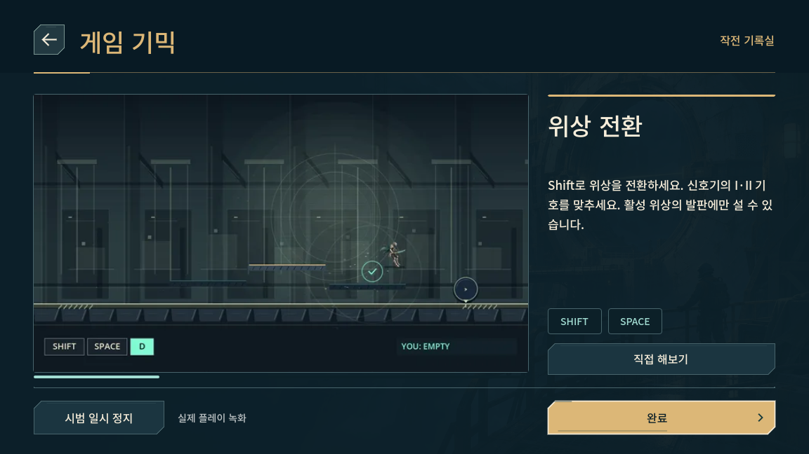

# STEAL THE RULES: SHIFT PROTOCOL

[English](../../README.md) · [简体中文](zh-CN.md) · [繁體中文](zh-TW.md) · [日本語](ja.md) · [한국어](ko.md)

SHIFT로 보스와 규칙을 교환하는 2D 액션 게임입니다. 상대의 능력을 빼앗으면 내가 가지고 있던 규칙이 보스에게 넘어갑니다.

[Windows 다운로드](https://github.com/Carey0216/steal-the-rules-shift-protocol/releases/latest/download/shift-protocol-windows-x64.zip) · [Web HTML5 다운로드](https://github.com/Carey0216/steal-the-rules-shift-protocol/releases/latest/download/shift-protocol-web.zip) · [v1.7.0](https://github.com/Carey0216/steal-the-rules-shift-protocol/releases/tag/v1.7.0)

## 플레이

Windows ZIP을 풀고 **ShiftProtocol.exe**를 실행하세요. 옆의 `runtime` 폴더를 유지하세요. Web 버전은 itch.io에 올리거나 HTTP 서버에서 데스크톱 브라우저로 실행합니다。

## 두 가지 모드

**프로토콜 도전**에서 여섯 보스와 연속으로 싸웁니다. 규칙을 다음 전투로 이어 가고 승리할 때 장갑을 최대 3 회복합니다. 현재 보스부터 재도전할 수 있으며, 보스 체력 67%와 34%에서 공격 패턴이 바뀝니다.

**작전**은 8개 지역, 48개 구역의 캠페인입니다. 위상 발판, 닻 위치 교환, 이동 발판, 화물 운반과 수호자 전투를 진행하며 자동 저장됩니다.

예고된 공격을 피하고 열린 코어에 접근하세요. 표시된 양쪽 규칙을 확인한 뒤 **SHIFT**로 교환하고 **E**로 사용합니다. RUSH는 위치 교환과 돌진 베기, LIFT는 보스 착지와 상승, AEGIS는 장갑 파괴와 근거리 반사를 제공합니다.

## 조작

| 동작 | 키보드 | 컨트롤러 |
| --- | --- | --- |
| 좌우 이동 | A / D | Stick / D-pad |
| 점프 | Space | A |
| 공격・길게 눌러 연속 공격 | J | X |
| 회피 | K | B |
| 규칙 교환 | Shift | RB |
| 능력 사용 | E | Y |
| 일시 정지 | Esc | Start |
| 재도전 | R | Back |
| 전투 시작 확인 | Enter | A |

키 변경, 글자 크기, 보조 모드, 동작 줄이기, 개별 음량과 화면 흔들림을 설정할 수 있습니다. 작전 기록실에서 실전 영상과 연습을 이용하세요.

## MONEY: 실험적 코인 편집

장비를 바로 시험해 볼 수 있는 숨겨진 기능입니다.

1. 로비의 코인 잔액을 **2.4초 안에 다섯 번 클릭**합니다.
2. **MONEY**를 입력하고 확인합니다.
3. 금액 입력 화면에서 **0～999999999** 사이의 정수를 입력하고 확인합니다.

저장된 코인 잔액만 변경하며 구역 해금이나 별 기록은 바뀌지 않습니다.

## 스크린샷

## 소스 실행

**Godot 4.7.2 표준 버전**으로 `project.godot`을 열고 F5를 누르세요. 내보내기는 [BUILD.md](../BUILD.md)를 참고하세요.

## 제작 및 라이선스

제작: Carey. Codex가 코드, 설계, 절차적 그래픽과 오디오, 번역 및 문서를 도왔습니다. 캐릭터, 포즈 시트와 배경은 OpenAI 이미지 생성을 사용했습니다. 실행 중 AI는 없습니다. [AI 사용](../AI-DISCLOSURE.md) · [소재 기록](../../assets/ART-NOTES.txt)

오리지널 파일은 [MIT](../../LICENSE), 글꼴과 Godot는 별도 라이선스를 따릅니다.
