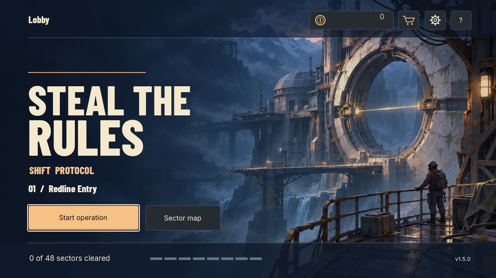

<h1 align="center">STEAL THE RULES: SHIFT PROTOCOL</h1>

  
  
  
  

[English](../../README.md) · **中文（简体）** · [中文（繁體）](../../docs/readme/zh-TW.md) · [日本語](../../docs/readme/ja.md) · [한국어](../../docs/readme/ko.md)

一款靠偷取规则改变战局的 2D Boss Rush。为 GitHub Game Off 2026 使用 Godot 和 GDScript 制作。

## 游戏特色

| 功能 | 游戏中的表现 |
| --- | --- |
| SHIFT 交换 | 躲过攻击，靠近开启的核心，按 **Shift**。你拿到 Boss 的能力，并把原有规则交给它。 |
| 48 关 / 八大区域 | 乘移动渡台、连击破中继器、接线开闸、穿过扫描光束、驻守信标，以闪避给蓄能器充能。原关卡重新调整，并新增五场 Boss 战。 |
| 地图与存档 | 每次通关点亮地图并开放下一关。已通关的关卡可重玩并重新结算。Esc 暂停，齿轮菜单可保存退出或确认清档。 |
| 实机引导 | 开场五课可以实练。新玩法首次出现时战前自动播放示范，大厅的 **？** 可回看，也能打开装备图鉴。 |
| 装备与商店 | 20 种图标装备。通关每次发 1000–3000 金币，战前最多购买三种不同装备。减益装备只会在对抗中掉落。 |
| 设置 | 可修改语言、显示模式、窗口大小和文字大小，也可切换声音、减少动效和辅助模式。Windows 首次启动默认全屏，之后记住你的选择。网页版在页面内启动，可在设置里切换全屏。 |

## 操作方式

| 操作 | 键盘 | 手柄 |
| --- | --- | --- |
| 开始 / 继续 | Enter | Start / A |
| 移动 | A/D 或方向键 | 左摇杆 / 十字键 |
| 跳跃 | 空格、W 或 ↑ | A |
| 挥刀（可按住） | J 或 Z | X |
| 闪避 | K 或 X | B |
| 偷取 / 交换 | Shift 或 Q | 右肩键 |
| 使用当前能力 | E 或 C | Y |
| 暂停 | Esc 或 P | Start |
| 重试当前区域 | R | Back / Select |

## 规则与恢复

**RUSH** 向前冲刺斩击。**LIFT** 向上喷射，上升时挥刀可破甲。**AEGIS** 挡下一击，Boss 在近处时反弹伤害。下一次 Boss 攻击结束或交换成功后，能力会重新充能。进入新区域最多恢复三格耐久，重试会恢复到进入本区域时的状态。

## 行动指南

1. **启动。** Windows x64 解压整包，双击 `ShiftProtocol.exe`。Web HTML5 版可通过本地 HTTP 服务打开 `index.html`，或把 ZIP 上传为 itch.io 浏览器游戏。浏览器里先点画面获得键盘焦点。
2. **完成第一次交换。** 看预警，攻击将到时按 K。跑向开启的核心，等到界面显示进入范围，按 Shift、Q 或右肩键。界面会显示交换双方的规则。E 或 Y 用技能，J 或 X 挥刀。失败时等下一次亮核，再靠近一点。
3. **用场地解机关。** 反射关站在标记上，预警要结束时按 E 用 AEGIS。回声锁等准星固定再离开。货物旁按 J 接驳，依次运到每个检查点。
4. **辨认气泡。** 场上没有气泡、掉落冷却已结束时，有效命中有 38% 掉率。气泡的环在 6 秒内耗尽，靠近自动生效 5–9 秒。薄荷绿是增益，珊瑚红是持续 5 秒的减益，可以跳过。装备图标旁有倒计时。
5. **金币和结算。** 通关先得一星，再按本关的用时、受击上限分别加星。每颗星 1000 金币，重玩也照当次成绩发放。商城 6000 金币起，从大厅购物车或入场前打开。每种装备限一件，下一次出战开始时装备才计时，详见 **？→ 装备图鉴**。
6. **重玩和存档。** 结算可重试、回大厅或进入下一关。齿轮菜单确认清档会清除关卡、星级、金币和已购装备，保留语言、显示和无障碍设置。

引导自动播放完整的实机战场，可暂停和重播。基础课点「亲手练习」即可试做。任务简报有检查点路线，商城逐件标明装备何时开始生效、持续多久。

## 运行与构建

在 Windows 上解压整个压缩包，双击 `ShiftProtocol.exe`，并保留旁边的 `runtime` 文件夹。使用桌面浏览器时，先点击游戏画面使其获得焦点。从源码运行时，用标准版 Godot 4.7.2 打开 `project.godot` 后按 F5。构建说明包含导出模板、测试和 Web、Windows 压缩包的制作方法。

[下载带标签的版本](https://github.com/Carey0216/steal-the-rules-shift-protocol/releases) · [构建说明（英文）](../BUILD.md) · [Game Off 2026](https://itch.io/jam/game-off-2026)

## 制作与许可

Carey 为 GitHub Game Off 2026 制作。OpenAI Codex 协助了设计、GDScript 编程、程序生成的画面和音效、测试及文档。游戏运行时不使用 AI。原创项目文件采用 MIT 许可。Barlow Condensed、Space Mono 及由 Noto Sans 制作的 Shift Sans 字体子集均附带 SIL Open Font License。Godot 及其依赖附带独立许可。

[MIT](../../LICENSE) · [SIL OFL](../../assets/) · [Godot](../GODOT_COPYRIGHT.txt)
