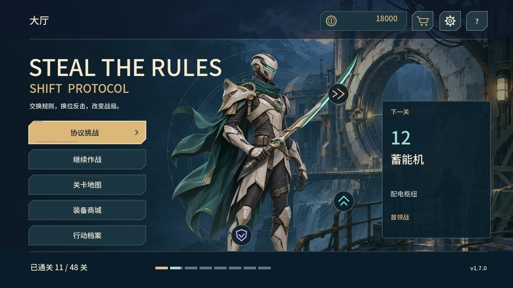
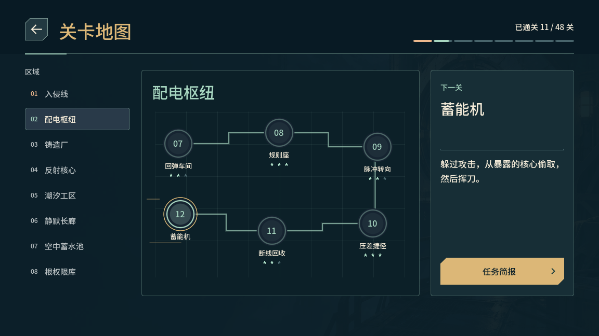
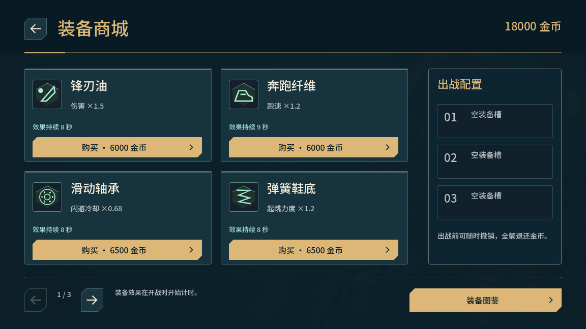
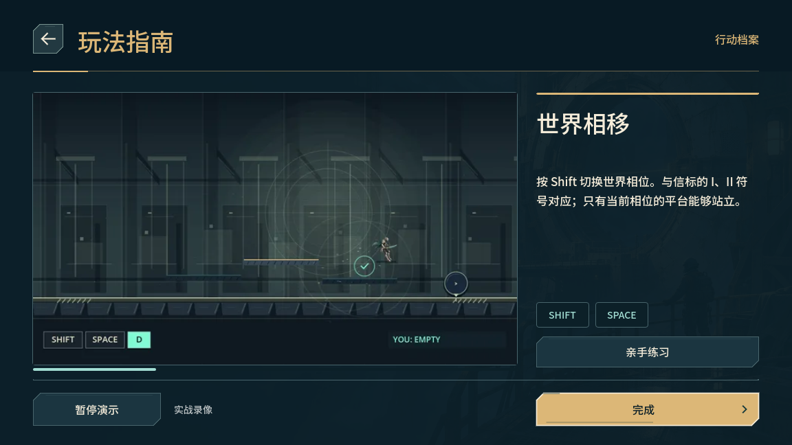

<h1 align="center">STEAL THE RULES: SHIFT PROTOCOL</h1>

  
  
  
  

  <a href="../../README.md">English</a> · <strong>中文（简体）</strong> · <a href="zh-TW.md">中文（繁體）</a> · <a href="ja.md">日本語</a> · <a href="ko.md">한국어</a>

一款靠偷取规则改变战局的 2D Boss Rush。为 GitHub Game Off 2026 使用 Godot 和 GDScript 制作。

## 游戏特色

| | |
| --- | --- |
| 六首领协议挑战 | 每位首领三个阶段；规则继承、装甲修复，可从当前首领重试。 |
| 48 关 / 八大区域 | 19 种路线机制、14 个 Boss 关卡，以及 13 条通关前有守卫截击的路线。每个区域都以 Boss 战收尾。 |
| Shift 的三种含义 | 与敌人交换规则、与锚点交换位置，以及切换世界相位，让另一组平台实体化。 |
| 极限闪避 | 攻击命中前闪避穿过，获得一次伤害 +4 的反击强化，2 秒内有效。普通闪避仍保留原有保护。 |
| 可撤销的出战配置 | 23 种短时装备，战前最多买三种。点击右侧已购槽位或撤销按钮，全额退还金币后即可换购。减益只在对抗中掉落。 |
| 引导与设置 | 29 段实机录像和练习，支持按键重设、分别调整总音量/音乐/音效及震屏强度。左下角常驻显示各动作和当前按键。 |

继续下一关，或打开地图、商城、档案和设置。

先选区域，再选关卡；出战前可以查看本关目标。

每件装备明确显示生效时长，点击右侧已购槽位即可退款。

世界相移教程：左侧播放实机操作，右侧列出说明和按键。

## 操作方式

| 操作 | 默认键盘按键 | 手柄 |
| --- | --- | --- |
| 菜单确认 | Enter | A |
| 向左移动 | A | ← Stick |
| 向右移动 | D | Stick → |
| 跳跃 | Space | A |
| 挥刀（可按住） | J | X |
| 闪避 | K | B |
| 相移 / 交换 | Shift | RB |
| 使用当前能力 | E | Y |
| 暂停 | Esc | Start |
| 重试 | R | Back |

## Shift 如何改变战局

夺走 **RUSH** 时，你与 Boss 交换站位并自动转向敌人；夺走 **LIFT** 会使 Boss 落地，悬阵机的甲板还会坍塌；夺走 **AEGIS** 会剥离装甲，产生短暂的增伤窗口。Boss 会接过你的旧规则，并改变下一招。交换前先看清双方图标。

## 协议挑战

大厅选择 **「协议挑战」**，直接迎战六位首领。过关继承规则、修复最多三点装甲；失败可从当前首领重试。通关后显示整轮用时、交换和重试次数。

首领在 **67%** 和 **34%** 血量处切换阶段，后续阶段加入回程冲刺、双重冲击波和更密集的脉冲阵。另有 **48 关行动战役**，地图进度、星级、金币和装备单独保存。

## 行动指南

1. 解压 Windows 整包，双击 **ShiftProtocol.exe**，保留旁边的 runtime 文件夹。首次默认全屏。选择语言，按顺序看完基础五课，也可点「亲手练习」试做。

2. 看红色蓄力预警。闪避或离开危险区后，靠近开启的核心，按 **Shift** 交换。按 **E** 使用夺来的能力；闪避条充满后才能再次闪避。

3. 攻击快碰到你时按 **K** 穿过，会触发极限闪避。金色环和音效表示反击就绪，2 秒内下一次挥刀命中可消耗强化，只有一次。

4. 相位关看 **I / II** 标记，按 Shift 激活对应平台。锚点关先进入大圆环，再按 Shift 交换位置。新机制会自动播放示范，之后可在大厅 **？** 回看。

5. 部分路线触发守卫截击，完成检查点后还要击败守卫才算通关。重玩也按每颗星 1000 金币发放奖励。商城已购槽位可在出战前全额撤销，再换另一件。购买装备持续 7–9 秒，开战才计时。

6. 齿轮打开设置。每个动作只有一个键；选择已占用的按键会互换两个动作的键位，左下角提示同步更新。总音量、音乐、音效、震屏可分别调节。Esc 暂停，「保存并退出」保留本地进度。

## MONEY：实验性金币修改

用于直接尝试不同装备，不必反复刷关攒金币。

1. 在大厅，**2.4 秒内连续点击金币余额五次**。
2. 输入 **MONEY** 并确认。
3. 出现「请输入修改金币数」后，输入 **0～999999999** 之间的整数，再次确认。

修改的是存档中的金币余额，不会解锁关卡或改变星级。游戏内保留隐藏入口。

## 运行与构建

网页版适用于桌面浏览器。通过 HTTP 服务打开 index.html，或将 Web ZIP 上传到 itch.io。源码使用标准版 Godot 4.7.2；构建说明包含导出步骤。

[下载带标签的版本](https://github.com/Carey0216/steal-the-rules-shift-protocol/releases) · [构建说明](../BUILD.md)

## 制作与许可

Carey 制作。Codex 协助代码、测试、文档，以及角色原画、动作姿态和大厅背景的生成。游戏运行时不使用 AI。原创项目文件采用 MIT，字体保留 SIL OFL，Godot 及其依赖保留各自许可。界面研究参考 Hell759735653 的《烬域》和 FunX 的《Foundation-基地-Game UI》，项目未打包它们的图片。

[美术与参考说明](../../assets/ART-NOTES.txt)
