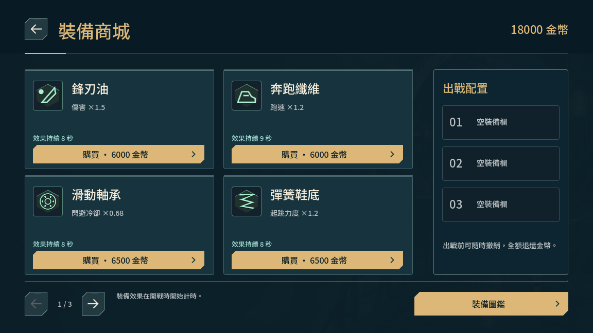

# STEAL THE RULES: SHIFT PROTOCOL

[English](../../README.md) · [简体中文](zh-CN.md) · [繁體中文](zh-TW.md) · [日本語](ja.md) · [한국어](ko.md)

一款以規則交換為核心的 2D 動作遊戲。按下 SHIFT，奪取首領的能力，同時把自己的規則交給它。

[下載 Windows 版](https://github.com/Carey0216/steal-the-rules-shift-protocol/releases/latest/download/shift-protocol-windows-x64.zip) · [下載網頁版](https://github.com/Carey0216/steal-the-rules-shift-protocol/releases/latest/download/shift-protocol-web.zip) · [v1.7.0](https://github.com/Carey0216/steal-the-rules-shift-protocol/releases/tag/v1.7.0)

## 開始遊戲

Windows 版解壓後執行 **ShiftProtocol.exe**，保留旁邊的 `runtime` 資料夾。網頁版可上傳 itch.io，或透過 HTTP 服務開啟 `index.html`，使用桌面瀏覽器遊玩。

## 兩種玩法

**協定挑戰**：連續迎戰六位首領。過關後繼承規則、修復最多三點裝甲，失敗可從目前首領重試。首領在 67% 與 34% 血量切換戰鬥階段。

**行動戰役**：八個區域、48 關，進度自動儲存。包含相位平台、錨點換位、移動渡台、貨物接力及守衛截擊。

觀察攻擊預警，閃避或跳出危險區，再靠近暴露的核心。交換前會預告雙方收到的規則。按 **SHIFT** 交換，按 **E** 使用：RUSH 交換站位並向前衝斬；LIFT 讓首領落地、讓自己升空；AEGIS 剝離裝甲，並能接下近處的一擊反彈傷害。

## 操作

| 操作 | 鍵盤 | 手柄 |
| --- | --- | --- |
| 向左／向右 | A / D | Stick / D-pad |
| 跳躍 | Space | A |
| 揮刀，可按住連續攻擊 | J | X |
| 閃避 | K | B |
| 交換規則 | Shift | RB |
| 使用能力 | E | Y |
| 暫停 | Esc | Start |
| 重試 | R | Back |
| 確認戰鬥簡報 | Enter | A |

可重設鍵盤操作，調整字體大小、輔助模式、減少動態效果、分項音量和畫面震動。行動檔案提供實戰示範及練習。

## MONEY：實驗性金幣修改

方便直接嘗試不同裝備。

1. 在大廳，**2.4 秒內連續點擊金幣餘額五次**。
2. 輸入 **MONEY** 並確認。
3. 出現金幣數量提示後，輸入 **0～999999999** 的整數，再次確認。

只會修改存檔金幣，不會解鎖關卡或改變星級。遊戲內保留隱藏入口。

## 遊戲畫面

## 從原始碼執行

以 **Godot 4.7.2 標準版**開啟 `project.godot`，按 F5 執行。匯出說明見 [BUILD.md](../BUILD.md)。

## 製作與授權

Carey 製作。Codex 協助程式、設計、程序繪圖與音訊、翻譯和文件；角色原畫、動作圖集和背景使用 OpenAI 圖像生成。執行時不使用 AI。[AI 使用說明](../AI-DISCLOSURE.md) · [素材記錄](../../assets/ART-NOTES.txt)

原創專案檔案採用 [MIT](../../LICENSE)，字型與 Godot 保留各自授權。
