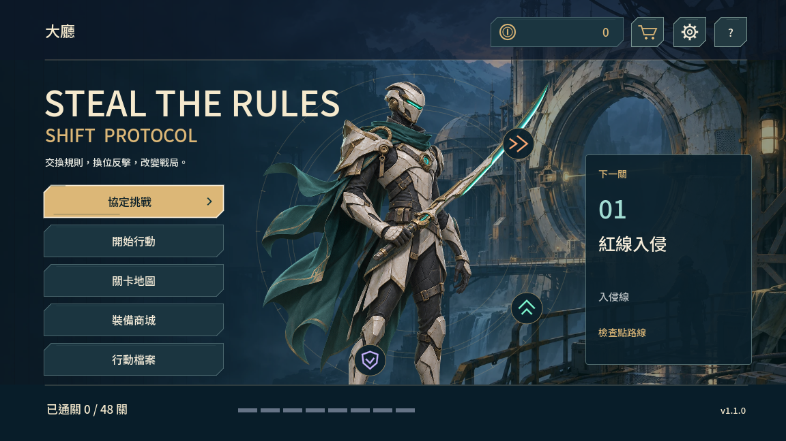
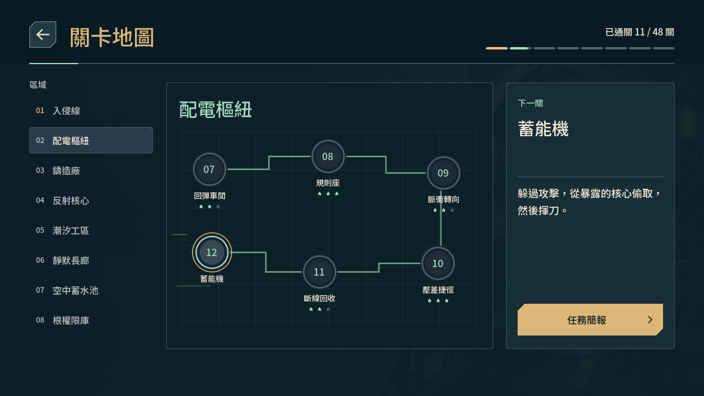
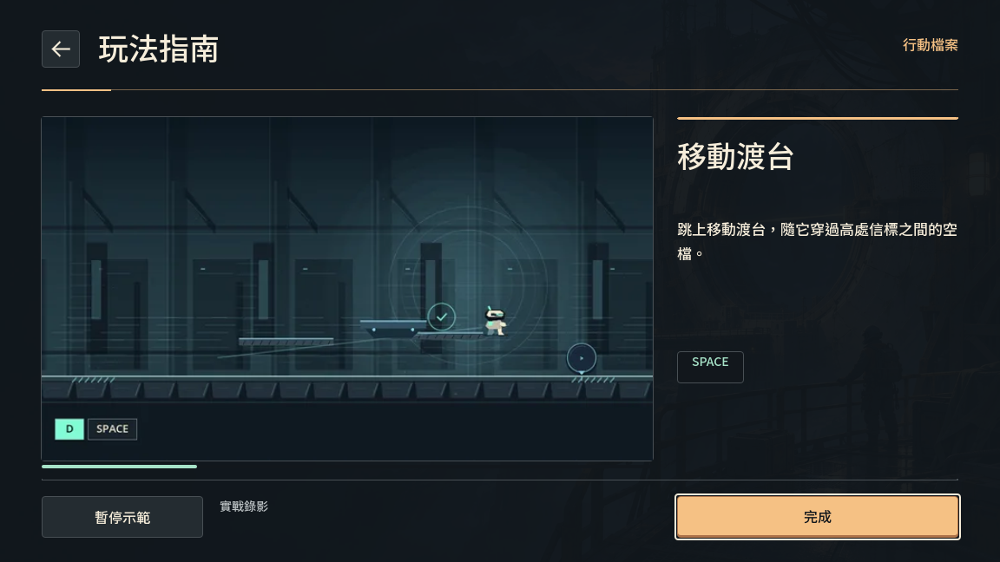

<h1 align="center">STEAL THE RULES: SHIFT PROTOCOL</h1>

  
  
  
  

  <a href="../../README.md">English</a> · <a href="zh-CN.md">中文（简体）</a> · <strong>中文（繁體）</strong> · <a href="ja.md">日本語</a> · <a href="ko.md">한국어</a>

一款靠偷取規則改變戰局的 2D Boss Rush。為 GitHub Game Off 2026 使用 Godot 與 GDScript 製作。

## 遊戲特色

| | |
| --- | --- |
| 六首領協定挑戰 | 每位首領三個階段，含規則繼承、裝甲修復及目前首領重試。 |
| 48 關 / 八個區域 | 19 種路線機制、14 個 Boss 關卡，以及 13 條終點有守衛截擊的路線。每個區域都以 Boss 戰收尾。 |
| Shift 的三種意義 | 與敵人交換規則、與錨點交換位置，以及切換世界相位，讓另一組平台實體化。 |
| 極限閃避 | 攻擊命中前閃避穿過，可強化下一次攻擊，傷害 +4，2 秒內有效。普通閃避仍保留原有保護。 |
| 可撤銷的出戰配置 | 23 種短時裝備，出戰前最多買三種。點擊已購槽位或撤銷按鈕即可全額退回金幣，再換購。減益僅在對抗中掉落。 |
| 指南與設定 | 29 段實機示範及練習，支援重設按鍵、獨立調整總音量/音樂/音效與震動畫面強度。左下角常駐顯示動作及按鍵。 |

繼續下一關，或開啟地圖、商店、檔案與設定。

先選區域，再選關卡，出戰前查看目標。

每件裝備會標明有效時間，點右側已購槽位即可退款。

世界相移教學：左側播放實機示範，右側列出步驟與按鍵。

## 操作方式

| 操作 | 預設鍵盤按鍵 | 手把 |
| --- | --- | --- |
| 選單確認 | Enter | A |
| 向左移動 | A | ← Stick |
| 向右移動 | D | Stick → |
| 跳躍 | Space | A |
| 揮刀（可按住） | J | X |
| 閃避 | K | B |
| 相移 / 交換 | Shift | RB |
| 使用目前能力 | E | Y |
| 暫停 | Esc | Start |
| 重試 | R | Back |

## Shift 如何改變戰局

奪取 **RUSH** 時會與 Boss 交換位置，並自動轉向敵人；奪取 **LIFT** 使 Boss 落地，懸陣機的甲板也會坍塌；奪取 **AEGIS** 剝離裝甲，產生短暫增傷窗口。Boss 會接過你的舊規則，改變下一招。交換前請確認雙方圖示。

## 協定挑戰

在大廳選擇 **「協定挑戰」**，連續迎戰六位首領。過關繼承規則、修復最多三點裝甲，失敗可從目前首領重試，通關後顯示整輪時間、交換和重試次數。

首領在 **67%** 與 **34%** 血量切換階段，加入回程衝刺、雙重衝擊波及擴展脈衝陣。另有 **48 關行動戰役**，地圖進度、星級、金幣和裝備分別儲存。

## 行動指南

1. 解壓縮 Windows 整包，執行 **ShiftProtocol.exe**，保留 runtime 資料夾。首次預設全螢幕。選好語言，依序看五課，或按「親手練習」試做。

2. 觀察紅色蓄力預警。閃避或離開危險區後，靠近開啟的核心並按 **Shift** 交換。**E** 使用能力，閃避條充滿後才能再次閃避。

3. 攻擊即將碰到你時按 **K** 穿過，觸發極限閃避。金色環與音效代表反擊就緒；2 秒內下一次揮刀命中會消耗一次強化。

4. 相位關查看 **I / II**，按 Shift 啟用對應平台。錨點關先進入大圓環，再按 Shift 交換位置。新機制會自動示範，之後可在 **？** 回看。

5. 部分路線需要在完成檢查點後擊敗守衛。重玩亦按每顆星 1000 金幣發獎。商店已購槽位在出戰前可全額撤銷再換購，購買裝備持續 7–9 秒，開戰才計時。

6. 齒輪開啟設定。每個動作只有一個按鍵，選已佔用的鍵會互換綁定，左下角提示同步更新。可分別調整總音量、音樂、音效與震動畫面。Esc 暫停，「儲存並離開」保留本機進度。

## MONEY：實驗性金幣修改

方便直接嘗試不同裝備。

1. 在大廳，**2.4 秒內連續點擊金幣餘額五次**。
2. 輸入 **MONEY** 並確認。
3. 出現金幣數量提示後，輸入 **0～999999999** 的整數，再次確認。

只會修改存檔金幣，不會解鎖關卡或改變星級。遊戲內保留隱藏入口。
