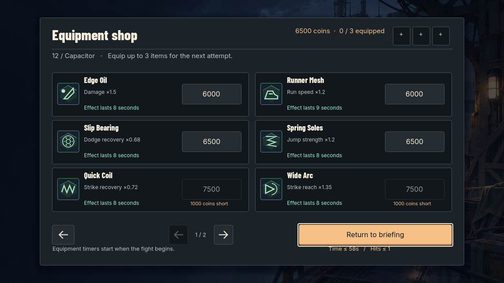

<h1 align="center">STEAL THE RULES: SHIFT PROTOCOL</h1>

  
  
  
  

[English](../../README.md) · [中文（简体）](../../docs/readme/zh-CN.md) · **中文（繁體）** · [日本語](../../docs/readme/ja.md) · [한국어](../../docs/readme/ko.md)

一款靠偷取規則改變戰局的 2D Boss Rush。為 GitHub Game Off 2026 使用 Godot 與 GDScript 製作。

## 遊戲特色

| 功能 | 遊戲中的表現 |
| --- | --- |
| SHIFT 交換 | 躲過攻擊，靠近開啟的核心並按 **Shift**。你取得 Boss 的能力，並把原有規則交給它。 |
| 48 關 / 八大區域 | 搭乘移動渡台、連擊破壞中繼器、接線開閘、穿越掃描光束、駐守信標，以閃避為蓄能器充能。原關卡經過調整，另有五場全新 Boss 戰。 |
| 地圖與存檔 | 通關點亮地圖並開放下一關。已通關的關卡可重玩並重新結算。Esc 暫停，齒輪選單可儲存離開或確認清除進度。 |
| 實機引導 | 開場五課可以親手練習。新玩法首次出現時，戰前會自動播放示範。大廳的 **？** 可重看，也能查看裝備圖鑑。 |
| 裝備與商店 | 20 種各有圖示的裝備。通關發 1000–3000 金幣，戰前最多購買三種不同裝備。減益裝備僅在對抗中掉落。 |
| 設定 | 可變更語言、顯示模式、視窗大小及文字大小，也可切換音效、減少動態效果和輔助模式。Windows 首次啟動預設為全螢幕，之後會記住你的選擇。網頁版在頁面內啟動，可在設定切換全螢幕。 |

## 操作方式

| 操作 | 鍵盤 | 控制器 |
| --- | --- | --- |
| 開始 / 繼續 | Enter | Start / A |
| 移動 | A/D 或方向鍵 | 左搖桿 / 十字鍵 |
| 跳躍 | 空白鍵、W 或 ↑ | A |
| 揮刀（可按住） | J 或 Z | X |
| 閃避 | K 或 X | B |
| 偷取 / 交換 | Shift 或 Q | 右肩鍵 |
| 使用目前的能力 | E 或 C | Y |
| 暫停 | Esc 或 P | Start |
| 重試目前區域 | R | Back / Select |

## 規則與修復

**RUSH** 向前衝刺斬擊。**LIFT** 向上噴射，上升時揮刀可穿透裝甲。**AEGIS** 擋下一擊，Boss 在附近時會反彈傷害。下一次 Boss 攻擊結束或交換成功後，能力會重新充能。進入新區域最多修復三格耐久，重試會恢復進入該區域時的狀態。

## 行動指南

1. **啟動。** Windows x64 請解壓縮整包，雙擊 `ShiftProtocol.exe`。Web HTML5 可透過本機 HTTP 伺服器開啟 `index.html`，或將 ZIP 作為 itch.io 瀏覽器遊戲上傳。先點畫面取得鍵盤焦點。
2. **完成第一次交換。** 看預警，攻擊即將到達時按 K。靠近開啟的核心，等介面顯示進入範圍後，按 Shift、Q 或右肩鍵。E 或 Y 使用規則，J 或 X 揮刀。交換失敗時等下一次開啟並再靠近一點。
3. **利用場地。** 反射關站在標記上，預警即將結束時按 E 用 AEGIS。回聲鎖等準星固定再離開。在貨物旁按 J 接駁，依序運到每個檢查點。
4. **辨認氣泡。** 場上沒有氣泡且冷卻結束時，有效命中的掉落機率為 38%。氣泡外圈在 6 秒內耗盡，靠近自動生效 5–9 秒。薄荷綠是增益，珊瑚紅是 5 秒減益，可以跳過。裝備圖示旁顯示倒數。
5. **金幣與評分。** 通關先得一星，再依該關的用時與受擊門檻各加一星。每顆星 1000 金幣，重玩也依當次成績發放。商店 6000 金幣起，可從大廳購物車或入場前開啟。每種限買一件，下一次出戰開始才計時。詳見 **？→ 裝備圖鑑**。
6. **重玩和存檔。** 結算可重試、回大廳或進入下一關。齒輪選單確認清檔會清除關卡、星級、金幣和已購裝備，保留語言、顯示與無障礙設定。

指南會自動播放完整的實機戰場，可暫停或重播。基礎課可按「親手練習」試做。任務簡報有檢查點路線，商店會標明裝備的效果時間與計時起點。

## 執行與建置

在 Windows 上解壓縮整個檔案，按兩下 `ShiftProtocol.exe`，並保留旁邊的 `runtime` 資料夾。使用桌面瀏覽器時，先點選遊戲畫面讓它取得焦點。從原始碼執行時，使用標準版 Godot 4.7.2 開啟 `project.godot` 再按 F5。建置說明包含匯出範本、測試及 Web、Windows 壓縮檔的製作步驟。

[下載帶標籤的版本](https://github.com/Carey0216/steal-the-rules-shift-protocol/releases) · [建置說明（英文）](../BUILD.md) · [Game Off 2026](https://itch.io/jam/game-off-2026)

## 製作與授權

Carey 為 GitHub Game Off 2026 製作。OpenAI Codex 協助設計、GDScript 程式、程式生成的畫面和音效、測試及文件。遊戲執行時不使用 AI。原創專案檔案採用 MIT 授權。Barlow Condensed、Space Mono 和源自 Noto Sans 的 Shift Sans 字型子集均附有 SIL Open Font License。Godot 和其相依套件附有獨立授權。

[MIT](../../LICENSE) · [SIL OFL](../../assets/) · [Godot](../GODOT_COPYRIGHT.txt)
